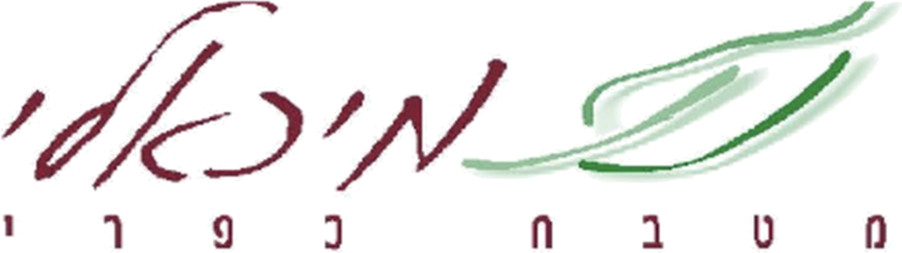

<div align="center">



# יהודית מיכאלי · שפית

**ארכיון המתכונים של השפית יהודית מיכאלי ומסעדת ״מיכאלי – מטבח כפרי״, רשפון**

כ-3,000 מתכונים מהמחברות שלה, 88 תפריטים מהמסעדה, והדמיות תלת-ממד שנבנו כולן בקוד.

[🌐 לאתר](https://yehudit-michaeli.vercel.app) · [הצהרת נגישות](https://yehudit-michaeli.vercel.app/accessibility) · [מדיניות פרטיות](https://yehudit-michaeli.vercel.app/privacy)

</div>

---

## על הפרויקט

יהודית מיכאלי ניהלה ברשפון מסעדה כפרית-צרפתית בשם ״מיכאלי – מטבח כפרי״. לאורך השנים שמרה אלפי מתכונים ותפריטים בתיקיות בגוגל דרייב. האתר הזה הופך את הארכיון הזה לספר מתכונים דיגיטלי:

- **קטלוג מלא:** כל המתכונים מסודרים לפי פרקים, תתי-פרקים, חגים ומטבחי העולם, לפי שמות הקבצים והתיקיות המקוריות. לחיצה על מתכון פותחת את הדף המקורי בדרייב.
- **מתכונים נבחרים במלואם (✦):** כ-240 מתכונים עברו עיבוד מלא. בעמוד שלהם יש הכפלת כמויות, המרה לגרמים, טיימרים, מצב בישול שלא נותן למסך להיכבות, רשימת קניות והדפסה.
- **ארכיון התפריטים:** 88 תפריטים מהשנים 2002–2009: תפריטי עונות, ערבי טעימות, ולנטיין, ט״ו באב, סילבסטר וסעודות עצמאות. שמות של לקוחות פרטיים הוסרו.
- **חיפוש בעברית** שמבין תחיליות (ו/ה/ב/ל/מ/ש/כ), אותיות סופיות וניקוד.

## תלת-ממד ואנימציות

כל ההדמיות פרוצדורליות, בלי מודלים או תמונות חיצוניים: Three.js r186, React Three Fiber 9 ו-drei.

| סצנה | איפה |
|---|---|
| **שולחן השפית**: סיר קוקוט מנחושת עם בורגיניון, אדים בשיידר, יין, נר מהבהב, זיתים, רוזמרין, בגט ואבק קמח. המצלמה זזה בגלילה | דף הבית |
| **ספר המתכונים**: ספר עברי שמדפדפים בו משמאל לימין, עם עיקול דף אמיתי | `/categories` |
| **גלובוס מטבחי העולם**: נקודות יבשות מ-Natural Earth וסיכה לכל מטבח | `/cuisines` |
| **מסדרון התפריטים**: כרטיסי תפריט מרחפים לאורך השנים, לאור נרות | `/menus`, `/restaurant` |
| **הסמל המוזהב**: הלוגו בתלת-ממד, מופק מה-SVG | `/about`, 404 |

נוסף על הסצנות יש הטיית תלת-ממד ואור שעוקב אחרי העכבר בכרטיסים, אפקט גלים בלחיצה, חשיפה בגלילה, רקע עם צבעים ועשבי תיבול שזזים לאט, ו-View Transitions בין עמודים. **כל התנועה נעצרת** בהגדרת ״הפחתת תנועה״ של המערכת או מתפריט הנגישות.

## נגישות, פרטיות ועוגיות (לפי החוק בישראל)

- **נגישות:** בנוי לפי ת״י 5568 ו-WCAG 2.2 AA, ותקנה 35 לתקנות שוויון זכויות לאנשים עם מוגבלות (התאמות נגישות לשירות). יש תפריט נגישות מובנה (<kbd>Alt+A</kbd>), ניווט מקלדת מלא, ניגודיות AA, חלופות טקסט לתלת-ממד וכפתור עצירה לכל אנימציה. ראו את [הצהרת הנגישות](src/pages/accessibility.astro).
- **פרטיות:** חוק הגנת הפרטיות ותיקון 13. אין הרשמה ואין טפסים, הפונטים מאוחסנים מקומית ואין טראקרים. מועדפים, רשימת קניות והעדפות נשמרים ב-localStorage בלבד.
- **עוגיות:** באנר opt-in, שבו ״דחייה״ זמינה באותה רמה כמו ״אישור״. מדידה אנונימית (Vercel Web Analytics, בלי עוגיות) נטענת רק אחרי אישור.

## טכנולוגיה

`Astro 7` (SSG) · `React 19` islands · `Three.js r186` + `@react-three/fiber` + `drei` · `Tailwind 4` · `MiniSearch` · `zod` · Vercel

```
data/            catalog.json (כל המתכונים, משמות קבצים) · recipes/ · menus/ · notes/ · taxonomy.json
src/pages/       עמודים (מתכונים, קטגוריות, חגים, מטבחים, מסעדה, תפריטים, חוק ונגישות)
src/three/       סצנות התלת-ממד
src/islands/     רכיבי React אינטראקטיביים
src/components/  רכיבי Astro (כרטיסים, תפריט נגישות, באנר עוגיות, חיפוש)
pipeline/        סקריפטים: משיכה מהדרייב, חילוץ, קיבוץ כפילויות, קטלוג, לוגו ופורטרט
```

### הרצה מקומית

```bash
npm install
npm run dev        # http://localhost:4321
npm run build      # בנייה סטטית לתיקייה dist/
npm run validate   # בדיקת הנתונים מול הסכמה
```

### עדכון הקטלוג מהדרייב

```bash
python3 -m venv .venv && .venv/bin/pip install pillow python-docx uharfbuzz fonttools brotli
YM_DRIVE_FOLDER_ID=<מזהה התיקייה> .venv/bin/python -I pipeline/01_fetch.py   # הורדה (מסמכים אישיים חסומים ולא יורדים)
.venv/bin/python -I pipeline/02_extract.py
.venv/bin/python -I pipeline/03_cluster.py
.venv/bin/python -I pipeline/06_catalog.py   # בונה את data/catalog.json משמות הקבצים
```

תיקיות `raw/` ו-`work/` (קבצי המקור) **לעולם לא נכנסות לריפו**.

## זכויות

- **קוד:** MIT.
- **מתכונים, תפריטים, טקסטים, לוגו ותמונות:** © משפחת מיכאלי, כל הזכויות שמורות.
- **מקורות חיצוניים:** במתכונים המלאים שמקורם חיצוני, אופן ההכנה נכתב מחדש עם קרדיט. פירוט בעמוד [הקרדיטים](src/pages/credits.astro).

<div align="center"><sub>נבנה באהבה, לכבודה של יהודית מיכאלי 🌿</sub></div>

---

### English

A recipe archive for chef **Yehudit Michaeli** and her French country restaurant in Rishpon, Israel. About 3,000 recipes are catalogued from the original Google Drive folders and open the source document. Around 240 featured recipes have full interactive pages. The site also holds 88 digitised restaurant menus and procedural 3D scenes: a chef's table hero, a page-turning Hebrew recipe book, a cuisine globe, a menu corridor and a gold emblem. It is built with Astro 7, React Three Fiber and Three.js r186, and follows Israeli accessibility law (IS 5568 / WCAG 2.2 AA) with a privacy-first, opt-in cookie policy.
